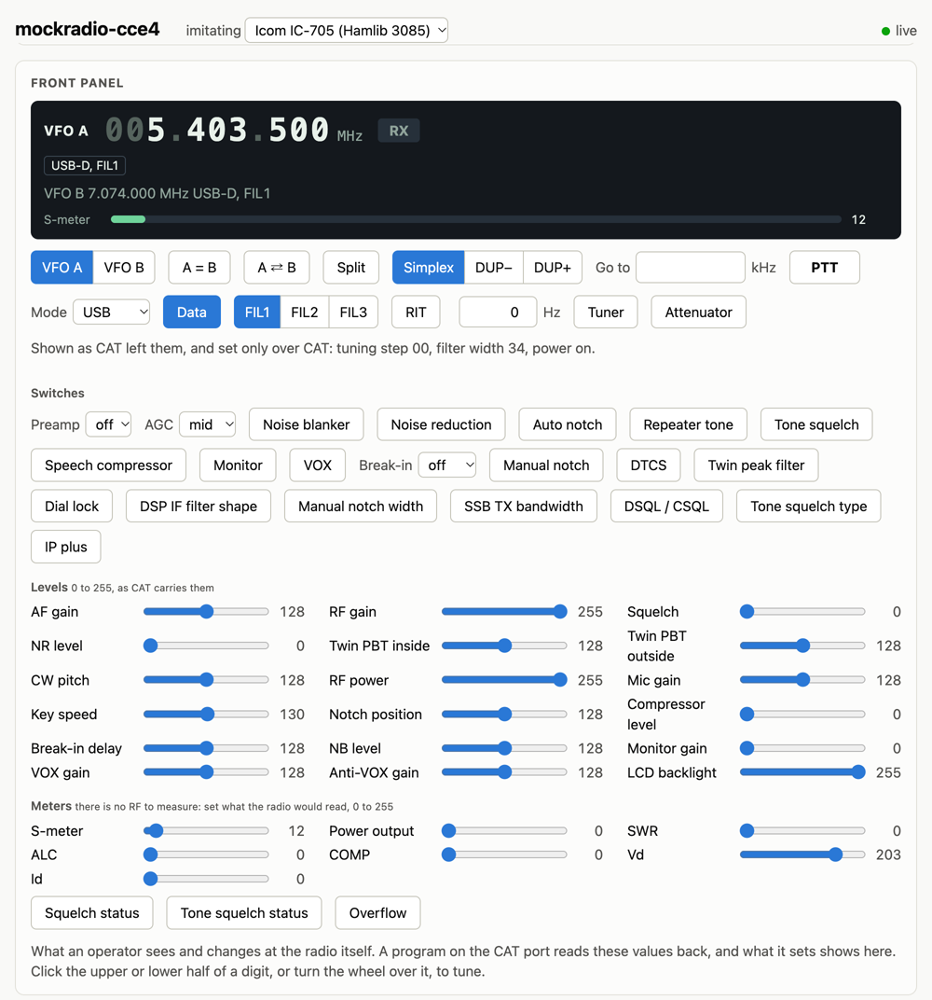
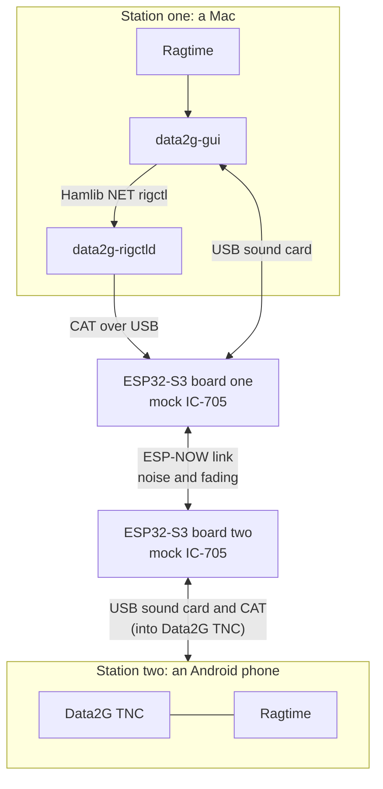
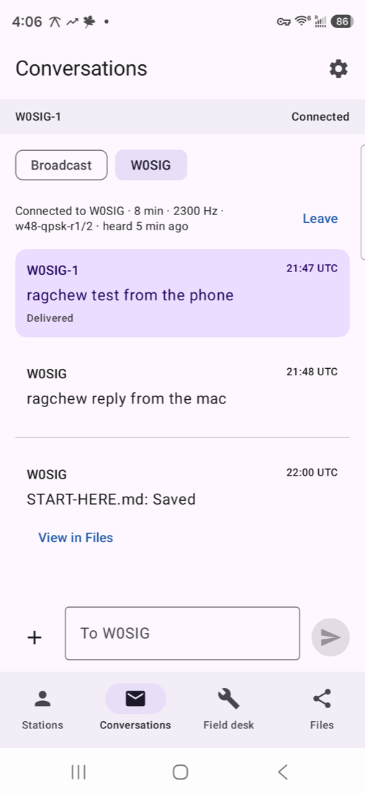
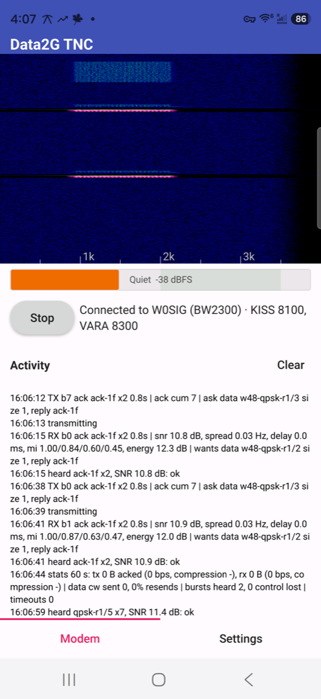
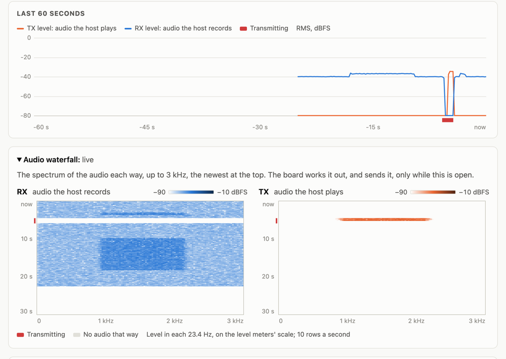

# esp32-mock-rig

A ham radio that isn't one. ESP32-S3 firmware that plugs into a computer or an Android phone over USB and shows up as a transceiver with a built-in sound card and CAT port, an Icom IC-705 or a Xiegu G90, so any software that drives a radio through Hamlib, or speaks CI-V itself, and takes audio from a sound card (WSJT-X, fldigi, VARA, Data2G and the like) drives it exactly as it would a real rig. Nothing in the firmware is specific to one modem. There is no RF. What the mock adds is a controllable channel: loopback, a parrot that plays your transmission back, noise at a set SNR, HF fading, and a link between two boards, so that two stations on one bench can hold a real ARQ session over a fake radio path.



*The board's web console. The header chooses the radio to imitate, an IC-705 or a G90, and the front panel below is that radio's. It's built from that radio's own CAT tables. What a program sets over CAT shows up here, and a change made here goes through the same CAT parser, so the program sees it on its next poll.*

## What works

Tested on ESP32-S3 boards on macOS 15 and an Android phone (Android 16). The software used for these tests was Hamlib 4.7.1's `rigctl` and, for the end-to-end test below, Data2G and Ragtime; other Hamlib or CI-V software should work the same way but has not been tried yet.

- **One USB device, two functions.** A 48 kHz mono sound card and a CDC serial port. macOS and Android both enumerate it and stream audio both ways; the loopback is bit-exact.
- **CAT as an IC-705 or a G90.** On the boards, `rigctl -m 3085` and `-m 3088` read and set frequency, mode and PTT with no Hamlib errors, and in the end-to-end test Data2G drove the radio through Hamlib. On the desktop, the same parser passes a wider `rigctl` sweep (levels, VFOs, split). The radio imitated is chosen at run time and kept in flash.
- **PTT** from CAT, a serial control line (RTS or DTR) or VOX, plus a key on the web console's front panel that a controller can see but not release.
- **A receive channel**: monitor (loopback), radio (muted while keyed), parrot (record each transmission, play it back after), and link (hear another board). Noise is on at power-up, at 10 dB SNR in 2500 Hz; in the end-to-end test Data2G measured 9.8 to 11.4 dB against it. HF fading uses the condition names and numbers of Data2G's own simulator (tested on the desktop, not yet on the boards).
- **Two boards linked over ESP-NOW** (or, not yet tried, three wires between their UARTs): 12 kHz audio in 10 ms packets with a jitter buffer and clock-drift correction. In testing no packet was lost. Two linked boards share one channel, so the path fades alike both ways.
- **A web console over Wi-Fi**: every setting, live telemetry, the board's own health, a front panel of the radio it imitates, and a waterfall of the audio each way.

### An end-to-end test: two stations on a bench

This is the setup used to test the boards end to end, not a requirement of the mock. Data2G and Ragtime happened to be the software at hand: Data2G as the modem (with its rigctld facade sharing the Mac's rig), Ragtime as the chat client on each end. Any other modem and client that work with a real IC-705 or G90 would sit in the same places.

Rig control on the Mac went through a rigctld built into a custom Data2G branch (`data2g-rigctld`), so that Data2G and Ragtime could share the radio. Hamlib's own `rigctld` would have done the same job; the built-in one was chosen to simplify setup, especially on the phone, where Data2G already owns the USB serial port and there is no separate rigctld to run.




In this test, broadcasts went both ways between Ragtime on a Mac and Ragtime on an Android phone, and a ragchew (a connected Data2G session) carried chat and a file, which arrived byte for byte.

<p>


</p>

*Left: Ragtime on the phone, in a ragchew with the Mac station. Right: Data2G on the phone decoding the Mac's burst, which went out through board one and arrived through board two.*



*The receiving board's web console during the test: a burst from the other station arrives over the link at 10 dB SNR (left), then this station answers (right), with receive muted while it transmits.*

## Hardware

An ESP32-S3-DevKitC-1 style board with the ESP32-S3-WROOM-1 N16R8 module (16 MB flash, 8 MB octal PSRAM). It has two USB jacks:

- **USB** (the S3's own): the mock radio. Plug this into the computer or phone.
- **COM / UART** (a USB-serial chip): flashing and the log. Optional once flashed.

No other parts are needed. For two stations, use two boards. A phone needs a cable or adapter that makes it the USB host; not every USB-C cable does this with these boards.

## Build and flash

The firmware builds with ESP-IDF v5.5.6. With ESP-IDF activated in the shell:

```bash
idf.py build
```

```bash
idf.py -p <COM port> flash monitor
```

The protocol, DSP, link and console code is portable C and builds and tests on a desktop with only a C compiler:

```bash
make -C host test
```

With Hamlib installed, this runs real `rigctl` against the CAT parser as each radio, with no board attached:

```bash
make -C host rigctl
```

## Using it

Point the modem program at the board's serial port and sound card as you would for the real radio: Hamlib model 3085 for the IC-705, or 3088 for the G90. The serial speed doesn't matter.

```bash
rigctl -m 3085 -r /dev/ttyACM0
```

The mock's own settings (route, noise, fading, parrot, link, PTT sources) are CI-V commands to address `F0` on the same serial port, sent with `mockctl.py`, or changed in the web console while a modem program holds the port:

```bash
python3 host/tools/mockctl.py -p <CAT port> route=parrot noise=on snr=5 fade=mpp
```

Some useful settings:

| Setting | Effect |
| --- | --- |
| `route=monitor` | Loopback: what the host plays comes straight back. Add `noise=off` for a bit-exact loop. |
| `route=parrot period=15` | Record each transmission and play it back one FT8 slot later. |
| `route=link` | Hear the other board, when both radios are on the same frequency. |
| `rig=g90` | Become a Xiegu G90, kept through restarts. |
| `vox=on keep` | Key on transmit audio, and keep the settings for power-up. |

**Web console.** The board joins the Wi-Fi network given in its own console or in `idf.py menuconfig`. With none, it hosts `mockradio-xxxx` (password `mockradio`), with the console at `http://192.168.4.1/`. Once joined, the console is at `http://mockradio-xxxx.local/`. It has no login, so keep it on a network you trust. Two boards link over ESP-NOW when they are on the same Wi-Fi channel: join both to the same network.

**Both radios must be on the same frequency.** If the two boards' radios are tuned to different frequencies, they silently fail to hear each other. Nothing is lost on the way: every packet arrives and is thrown away, just as a real receiver tuned elsewhere hears nothing. That is a choice, made to behave like real radios, not a physical limit: nothing in the system actually tunes, and the link carries the audio whatever the dial says. The only sign is in `link` in `/api/telemetry`. `off_frequency` counts the packets thrown away, `peer_tx` is the frequency the other board transmits on, and `state` reads `off frequency` while the other board is transmitting on another one. So when one station stops hearing the other, compare the two dials first. If you would rather the boards always hear each other, turn the setting `match` off ("Frequency match" in the console, or `mockctl.py -p PORT match=off`) on the receiving board, or on both.

**The link's radio.** Cheap, off-brand boards can have very feeble radios. With the DevKitC-1 clones used here, the author had to get the two boards within about 15 cm of each other to see a signal stronger than −50 dBm. A few centimetres of movement, or a cable routed differently, moved it by 20 to 30 dB. Below about −60 dBm the link starts losing audio, and at −80 dBm a fifth of the packets failed and no session connected. If sessions fail, decodes come out weak, or the other station seems to miss transmissions, look at the link before blaming the modem. Its numbers are in the console's "Link to the other board" card, and in `link` in `/api/telemetry`:

| Field | What it says |
| --- | --- |
| `rssi` | The other board's signal as this board hears it, in dBm. Aim for −50 or better. |
| `send_failed` | Audio packets the radio could not deliver to the other board. It should stay still. |
| `lost` | Gaps in what arrived from the other board. It should stay at 0. |
| `late`, `underruns`, `skipped` | Packets that arrived late or in bunches. The buffer rides out a few; a steady climb means the link is marginal. |

To watch them while a session runs, poll each board every few seconds and keep the output, so that a failure can be lined up with the state of the link at that moment. If the `.local` name is slow to resolve, use the board's IP address, which its log prints when it joins the network:

```bash
while sleep 2; do curl -s http://mockradio-xxxx.local/api/telemetry | python3 -c 'import json,sys,time; l=json.load(sys.stdin)["link"]; print(time.strftime("%H:%M:%S"), "rssi", l["rssi"], "sent", l["sent"], "failed", l["send_failed"], "received", l["received"], "lost", l["lost"], "late", l["late"], "underruns", l["underruns"])'; done
```

Move or turn the boards while it runs to find a good spot: one that holds −50 dBm or better, with `send_failed` and `lost` standing still.

**No board yet?** The host simulator serves the console for two simulated, linked boards at `http://localhost:8080` and `:8081`, each with a CAT serial port that Hamlib can drive:

```bash
make -C host radio-sim
```

## Limits

- No RF and no analog audio: it is for testing software, not for operating.
- It is functionally equivalent to each radio's USB port, not a copy of it: one sound card and one serial port, with its own USB IDs (pid.codes test VID `1209`). Software that picks devices by name or ID will see different ones.
- The G90 personality is built from Xiegu's CAT manual and Hamlib's source, never compared with a real G90.
- Tested so far on macOS 15 and Android 16; Linux and Windows are not yet tried.

## Documents

| File | Purpose |
| --- | --- |
| [DESIGN.md](DESIGN.md) | The living design: architecture, USB and CAT details, the bring-up on hardware, decision log, open questions |
| [AGENTS.md](AGENTS.md) | Instructions for coding agents working in this repository |
| [HANDOFF.md](HANDOFF.md) | The original project handoff, kept as a snapshot |

## License

MIT; see [LICENSE](LICENSE). The firmware builds on ESP-IDF, TinyUSB and Espressif's `usb_device_uac` and `mdns` components, which keep their own licenses.
